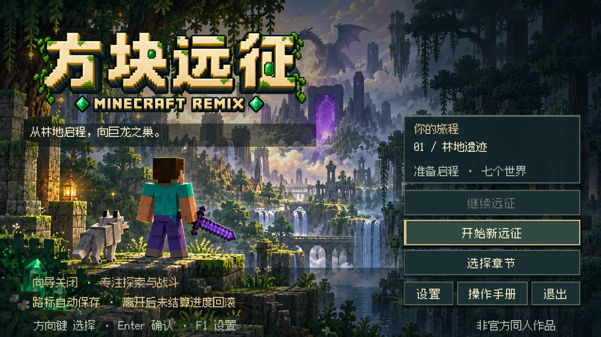
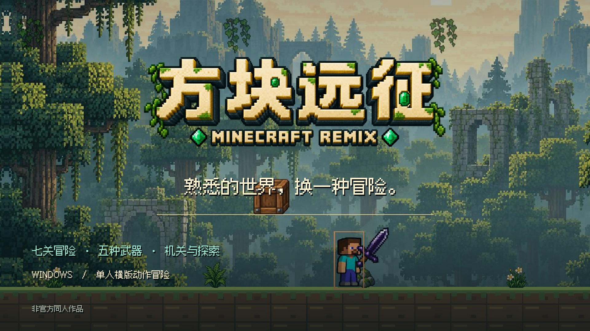

# Minecraft Remix

**熟悉的方块世界，换一种冒险。**

Minecraft Remix（中文副标题：方块远征）是一款使用 Godot 制作的 Windows 单人像素横版动作冒险。扮演 Steve，穿过七个风格各异的区域，把近战、远程、跳跃探索和机关解谜连成一场远征。

**Windows x64 · 键盘 / 手柄 · 七关主线 · 五种武器 · 十六首音乐**

[下载 Windows 游戏](https://github.com/MyLittleShrimp/Minecraft-Remix/releases/tag/v0.2.0.66) · [安装说明](docs/INSTALLATION.md) · [游戏介绍](docs/GAME_OVERVIEW.md) · [截图画廊](docs/SCREENSHOTS.md) · [65 秒玩法预告](docs/TRAILER.md) · [从源码运行](docs/BUILDING.md)

## 冒险里有什么

- **在跳跃中战斗。** 挥剑、跳劈、蓄力射箭，跨过沟壑与火堆，在高低错落的平台间寻找出手机会。
- **带上适合你的两把武器。** 下界合金剑、弓、双发弩、重斧、三叉戟逐步解锁；武器架提供图例、招式说明与双槽配装。
- **把收集变成战斗力。** 20 颗绿宝石释放一次武器大招：巨剑爆击、箭雨、三道从天而降的索敌闪电。绿宝石能带往下一关。
- **看见问号，跳起来。** 顶砖拾取蘑菇，砍开裂纹藏宝箱。增伤、回血、短暂无敌与攻速强化，让支线探索有不同回报。
- **给远征留一点口粮。** 跳跃和战斗消耗饱食度，面包与小动物掉落的食物帮助续航；找补给与赶路之间需要取舍。
- **机关也能成为你的武器。** 搬运 TNT、爆破开路、旋转灵魂导流管，在战斗之外观察环境。
- **每一关都有新威胁。** 从苦力帕、骷髅射手、蜘蛛，到女巫、恶魂、猪灵与更多敌人，关底还有独立 Boss 遭遇与专属音乐。

## 先看一段实机

预告展示顶砖吃蘑菇、五种武器、三道落雷、跑酷与机关，保留最终战和结局的悬念。完整 MP4 随 Release 提供；播放与素材说明见 [预告片页](docs/TRAILER.md)。

## 开始游玩

1. 打开 [v0.2.0.66 下载页](https://github.com/MyLittleShrimp/Minecraft-Remix/releases/tag/v0.2.0.66)，下载 `MinecraftRemix-v0.2.0.66-Windows-x64.zip`。
2. 完整解压到一个文件夹，双击 `MinecraftRemix.exe`。这是免安装便携版，无需安装 Godot 或 Minecraft。
3. 从主菜单开始新远征，也可以选择单关游玩。第一次玩建议开启向导。

当前测试版 **v0.2.0.66**，包含七关主线、七首 Boss 专曲、音乐开关与失败菜单焦点修复。详细变化见 [版本说明](docs/RELEASE_NOTES.md)。

| 操作 | 默认按键 |
| --- | --- |
| 移动 / 跳跃 | A、D / 空格 |
| 穿过单向平台 | S + 空格 |
| 攻击 / 蓄力 | J |
| 切换武器 / 大招 | K / L |
| 交互、武器架 | E |
| 斜上瞄准 | W + 远程攻击 |
| 暂停 / 设置 / 全屏 | Esc / F1 / F11 |

手柄可在设置中选择设备、自定义映射和摇杆死区。右下角音符按钮开关背景音乐；新手向导可随时关闭。

## 当前边界

这是持续打磨中的单人测试版。双人合作、武器升级系统尚未实现；主要验证平台为 Windows x64，其他系统与最低配置尚未完整验证。欢迎通过 Issue 提供版本号、关卡、复现步骤和截图。

## 开发与素材

工程使用 Godot 4.7.2、GDScript 与 Compatibility 渲染。源码包含运行所需场景、脚本、字体、美术与十六首音频；运行与导出步骤见 [开发说明](docs/BUILDING.md)。

本项目为 **非官方 Minecraft 同人作品**，与 Mojang、Microsoft 无关联，也不是官方 DLC。部分美术经 ImageGen 辅助生成并整理接入；音乐由项目作者提供。引擎、字体与素材说明见 [鸣谢与素材说明](docs/CREDITS.md)。
